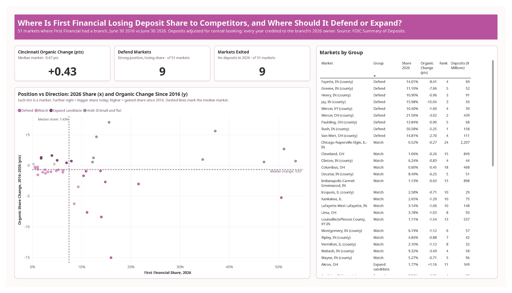
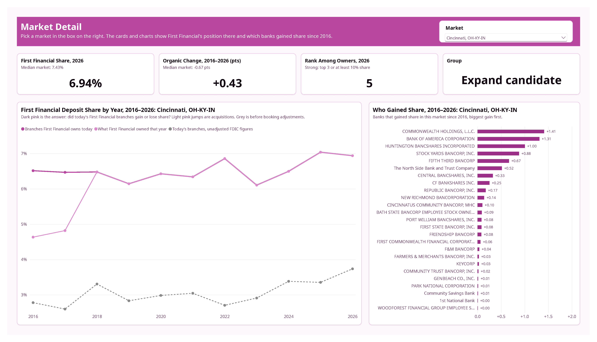
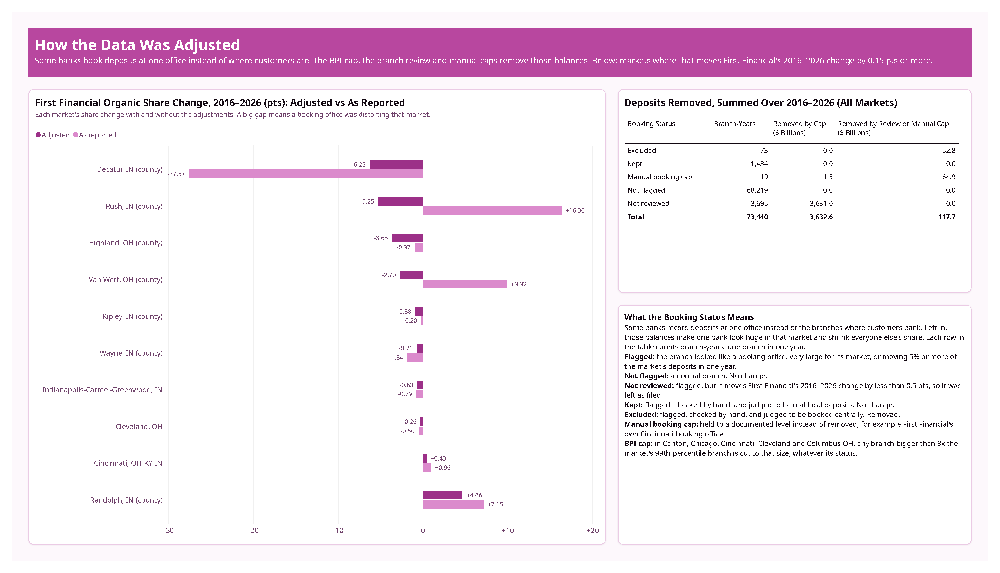

# First Financial Deposit Market Share, 2016–2026

Where is First Financial Bank losing deposit share to competitors, and where should it defend or expand? This project answers that question for all 51 local markets the bank served from 2016 to 2026, using FDIC branch deposit data and a Power BI report.

**In short:** First Financial is losing ground in the small Indiana towns it gained when it bought MainSource Bank in 2018, mostly to local community banks, even though those markets grew. Its home market, Cincinnati, is holding steady. The recommendation is to defend the 9 markets where it is still strong but slipping.

**Dashboard:** [View the live report in Power BI](https://app.powerbi.com/view?r=eyJrIjoiMjc3NTVhNTMtYzNlMS00MDIyLTkzYjMtMzhmZjg0YTdmNDRhIiwidCI6IjVhMmZlNzJiLTQ4YWEtNGZlZi1hZTg3LTMzM2EzNGQ3ZjUwZCJ9&pageName=6d47148dc90bbed8ac47). The source is `ffb_powerbi.pbip` in this repo.

**On a phone:** the report has a phone layout, but the public link always opens the desktop layout. Publish to web doesn't support phone layouts ([Microsoft Learn](https://learn.microsoft.com/en-us/power-bi/collaborate-share/service-publish-to-web)). The phone layout shows only in the Power BI mobile app, for viewers who have access to the report. The screenshots below show it.







**Phone layout**


## Findings

Share is First Financial's slice of all bank deposits in a market. Changes are in percentage points (pts): going from 10% to 9% is −1 pt. Every change covers 2016 to 2026 and counts only the branches First Financial owns today, so buying another bank doesn't count as a gain. Deposits that banks record at one office instead of where customers bank are adjusted out (see Decisions). Figures come from `reports/tables/`, written by `analyze.py`.

- **The biggest losses are in the former MainSource markets, and they started after the 2018 merger.** MainSource was an Indiana bank First Financial bought in 2018. Jay County, IN fell from 31.0% to 16.0% (−15.04 pts), Fayette, IN from 22.4% to 14.0% (−8.41) and Greene, IN from 18.8% to 11.1% (−7.66). All three are markets where First Financial still ranks in the top 5.
- **Local community banks took that share, not the big national banks.** First Berne gained 15.6 pts in Jay. Owen Financial (+10.0) and Farmers & Mechanics (+9.4) gained in Greene, and Union Savings (+5.8) and FCN (+4.3) in Fayette. First Farmers gained 7.4 in Wabash, IN. In Decatur, IN, Napoleon Bancorp gained 13.6 and Bancorp of Southern Indiana, which had no deposits there in 2016, now holds 12.3%.
- **These markets grew while First Financial shrank.** Jay's total deposits grew 78% while First Financial's fell 8%. In Louisville, the market grew 87% and First Financial's deposits fell 22%. First Financial is losing ground in growing markets, not in shrinking towns.
- **Cincinnati, the home market, is roughly holding.** First Financial went from 6.51% to 6.94% (+0.43 pts) and ranks 5th. As reported to the FDIC, the gain looks bigger (+0.96), because the bank books deposits from other markets at its Cincinnati offices.
- **Every exit was a branch closure, not a sale.** First Financial left 9 markets by closing 10 branches. Five of the exits came right after 2017, around the MainSource merger.
- **The 2025–2026 drop in Cleveland and Akron is mostly a bookkeeping move, not customers leaving.** After First Financial bought Westfield Bank, an Ohio bank (deal closed November 3, 2025), Westfield's deposits were moved onto the books of a Cincinnati office. This project takes that block out of Cincinnati, so it shows up as a loss in the markets the money was recorded in before.
- **Recommendation: defend the 9 markets where First Financial is strong but losing share, starting with Jay, Fayette and Greene.** A next step is to look into why customers there moved to local community banks: pricing, products or branch service. The 6 "expand candidate" markets, led by Wayne, OH (+1.61 pts) and Cincinnati, are where the bank is gaining share but is not yet a top player.

## Question

In which local markets is a regional bank losing deposit share to competitors, and where should it defend or expand?

The bank is First Financial Bancorp (Cincinnati, OH), holding company of First Financial Bank: 162 branches and $17.8B in deposits across Ohio, Indiana, Illinois, Kentucky and Michigan in 2026.

## How the Markets Are Grouped

Each of the 51 markets First Financial served goes into one group, based on how strong its position is today and which way its share moved. "Strong" means First Financial ranks top 3 in the market or holds at least 10% of its deposits. Top 3 is the footprint test banking analysts use ([American Banker](https://www.americanbanker.com/news/ranking-branch-footprints-and-franchise-value)); the 10% line is this project's own.

| Group | Rule | Markets |
|---|---|---|
| Defend | Strong, and lost more than 0.25 pts | 9 |
| Watch | Not strong, and lost more than 0.25 pts | 16 |
| Expand candidate | Not strong, and gained more than 0.25 pts | 6 |
| Hold | Strong, and did not lose more than 0.25 pts | 9 |
| Small and flat | Not strong, and moved 0.25 pts or less | 2 |
| Exited | Had branches in 2016–2025, no deposits in 2026 | 9 |

## Data

- **Source:** FDIC Summary of Deposits (SOD), pulled from the [FDIC BankFind API](https://api.fdic.gov/banks/sod) (`/sod` and `/history`). The SOD is the FDIC's yearly survey of deposits at every branch of every FDIC-insured bank, as of June 30.
- **Latest release:** June 30, 2026 data, published September 18, 2026 ([FDIC press release](https://www.fdic.gov/news/press-releases/2026/fdic-releases-results-summary-deposits-annual-survey)).
- **Downloaded:** November 5, 2026, by `download.py`.
- **Window:** 11 surveys, 2016–2026. This is longer than the 5 years or less the FDIC usually uses when it credits past years to today's owners, because the further back you go, the more the picture leans on the banks that survived ([FDIC Quarterly, 2019](https://www.fdic.gov/analysis/quarterly-banking-profile/fdic-quarterly/2019-vol13-1/fdic-v13n1-4q2018-article.pdf)). I kept 10 years so MainSource's years before the merger stay in.
- **Scope:** every branch of every bank in each county where First Financial, or a bank that later merged into it, had a branch. That is 73,440 branch-years (one branch in one year) in 131 counties.
- **Units:** SOD amounts are in thousands of dollars.
- **Check:** First Financial Bank's 2026 SOD total ($17,801,476K) matches the deposits in its Call Report, the quarterly financial filing banks make to regulators.

## Cleaning Log

Row counts printed by `clean.py`.

| Step | What happens | Result |
|---|---|---|
| 1 | Load raw branch-year rows from 11 yearly files | 73,440 rows |
| 2 | Assign each county to a market | 131 counties; 56 markets (17 metro, 39 county) |
| 3 | Find banks that merged into another bank by 2026 | 562 banks; 142 merged |
| 4 | Credit every row to the branch's 2026 owner | 62,093 open in 2026; 895 via merger chain; 10,081 closed, bank still operating; 371 closed, no successor in data |
| 5 | Build the owner list | 581 owners (1 focus bank) |
| 6 | Build the fact table | 73,440 rows; 11 years |
| 7 | BPI cap in 5 markets | 209 rows capped; $3,632.6B removed (30.1% of reported deposits, summed over all years) |
| 8 | Apply the booking review | 534 flagged branches; 73 excluded branch-years; $52.8B removed (0.4%) |
| 9 | Apply manual booking caps | 19 of 19 rows; $64.9B removed (0.5%) |
| 10 | Checks | 10 of 10 pass: no rows lost, deposits by year match raw, no negatives, adjusted ≤ capped ≤ reported |
| 11 | Write tables | 5 tables to `data/clean/` |

The fact table keeps three deposit columns, so every number can be shown both ways: `deposits_000` (as reported), `deposits_capped_000` (after the cap) and `deposits_adjusted_000` (after the cap, the review and the manual caps).

## Decisions

Each judgment call, and why.

- **Markets are 2026 metro areas (MSAs, the Census Bureau's metro regions), or the county outside metro areas.** The Federal Reserve's banking markets mostly follow metro areas and rural county lines, but its official definitions are drawn by hand. This is a stand-in for Fed banking markets, not the official definition. Each county's market is fixed from 2026 for all years, because 8 of the 130 counties pulled changed MSA code during the window.
- **Every past year is credited to the branch's 2026 owner.** A branch keeps its FDIC location number through mergers, so I follow each branch forward to its 2026 owner. That separates real wins and losses ("organic" change, the dashboard's "Branches First Financial owns today" line) from share bought through acquisitions. The FDIC's own market-share tool does this only for proposed deals and doesn't restate history, so this restatement is my own build.
- **Closed branches are credited to their last owner, then carried forward through mergers.** I used 2,284 FDIC merger events from July 2016 to June 2026, so a closed MainSource branch counts as First Financial's.
- **Competitors are counted at holding-company level.** Two banks with the same parent are one competitor.
- **Centrally booked deposits are capped or removed.** Some banks record deposits at one office instead of the branch near the customer, which makes them look huge in one market and shrinks everyone else's share. Two layers handle this:
  - **The BPI cap:** no branch can count for more than 3× the size of a branch bigger than 99% of the branches in its market that year. The cap applies only in markets where it kicks in for at least 9 of the 11 years: Canton, Chicago, Cincinnati, Cleveland and Columbus, OH. The method comes from the [Bank Policy Institute (2022)](https://bpi.com/wp-content/uploads/2022/07/Our-Search-for-an-Urban-Banking-Market-Made-Less-Competitive-by-a-Banking-Merger.pdf), a large-bank trade group that argues market concentration is overstated.
  - **A branch-by-branch review** for anything the cap misses (see Booking Review).
- **First Financial's own Cincinnati booking office gets the same treatment as competitors'.** The cap trims Fifth Third's and U.S. Bank's Cincinnati headquarters records but barely touches First Financial's. So First Financial's Cincinnati booking records are held to set levels for 2016–2026. The Fed adjusts the bank under review only where it can adjust its competitors the same way ([Fed FAQ, Q23](https://www.federalreserve.gov/bankinforeg/competitive-effects-mergers-acquisitions-faqs.htm)).
- **Alternative considered: the FDIC's September 22, 2026 proposed rule.** It would spread a bank's centrally booked deposits across markets by population ([Federal Register](https://www.federalregister.gov/documents/2026/09/22/2026-19308/merger-transactions)). I didn't use it because it's a proposal, it covers FDIC reviews only, and the Fed and DOJ haven't adopted it.
- **Thrift deposits count at 100%.** Thrifts are savings banks and savings and loans. The Fed's first screen counts their deposits at 50%. Thrifts held only 4.6% of deposits in 2016 and 2.0% in 2026, so I didn't weight them. Four county markets have a high thrift share, where weighting would matter: Fulton, IN (48.0%), Greene, IN (47.5%), Van Wert, OH (44.5%) and Fayette, IN (35.2%).
- **First Financial Bancorp was picked over larger Cincinnati banks.** Fifth Third books $32.9B at its headquarters and U.S. Bank operates nationally, so neither has a clean local footprint. LCNB is too small to compare across many markets.

## Booking Review

A booking office is a branch where a bank records deposits from customers elsewhere. `review_booking.py` flags any branch that looks like one: very large for its market, or moving 5% or more of the market's deposits in one year. A flag counts only when the deposits cross into another market or leave the market's records. Each flagged branch that moves First Financial's share change by 0.5 pts or more gets checked by hand against filings and press releases.

**534 flagged branches = 7 excluded + 156 kept + 371 not reviewed.**

| Status | Meaning | Branch-years |
|---|---|---|
| Not flagged | A normal branch, used as filed | 68,219 |
| Not reviewed | Flagged, but moves First Financial's change by less than 0.5 pts, so left as filed | 3,695 |
| Kept | Checked by hand and judged to be real local deposits | 1,434 |
| Excluded | Checked by hand and judged to be centrally booked, so removed | 73 |
| Manual booking cap | Held to a documented level instead of removed | 19 |
| **Total** | | **73,440** |

- **Excluded branches:** Rush, Decatur, Van Wert, Highland, Randolph, Wayne and Ripley. Each has a source in `data/reference/booking_overrides.csv` or `booking_review.csv`, for example the [Flagstar 8-K](https://www.sec.gov/Archives/edgar/data/1033012/000103301218000074/a8-kcurrentreport20180605.htm) for Rush.
- **Manual caps** (`data/reference/booking_adjustments.csv`, 19 rows):
  - First Financial's Cincinnati booking offices.
  - Merchants Bank's Carmel main office from 2020, which holds mortgage-servicer escrow deposits.
- **Rush, shown both ways:** First Financial's Rush share rose 16.36 pts as reported but fell 5.25 pts adjusted. The reported gain mostly comes from a competitor's deposits leaving the county's books after Wells Fargo sold its branch in 2018.
- **Van Wert and Decatur:** Van Wert flips from +9.92 as reported to −2.70 adjusted. Decatur's reported −27.57 shrinks to −6.25, because the reported figure includes the MainSource headquarters booking.

## Data Gaps

- **Banks choose how they assign deposits to branches.** The FDIC lets each bank use its own method, so branch figures are the bank's allocation, not a count of where customers live.
- **Credit unions aren't in the SOD.** They report to the NCUA, so their share is missing from every market ([Fed FAQ, Q18](https://www.federalreserve.gov/bankinforeg/competitive-effects-mergers-acquisitions-faqs.htm)).
- **Branch-only sales and moves inside one bank aren't tracked.** Mergers are followed through FDIC history, but a single branch sold without a merger, or deposits moved between a bank's own branches, can still show up as a gain or loss.
- **Rush, 2016–2017:** Wells Fargo branch 2882 fell from $197M to $115M before the 2018 sale. The cause is unknown.
- **U.S. Bank, Wayne County, IN (branch 203533):** jumped from $22M to $476M in 2024. It was reviewed and kept, and it moves First Financial's change by 0.75 pts.
- **Wells Fargo, Fort Wayne (branch 8658):** fell from $1.16B to $31M. It wasn't reviewed because it moves First Financial's change by only 0.10 pts.
- **Truist, Louisville (branch 364386):** looks like booking but was left in. Removing it changes First Financial's Louisville result from −1.54 to −1.46 pts.
- **First Financial's 2024 Cincinnati baseline is assumed.** The cap on its 4th & Vine office in Cincinnati holds 2025 at the 2024 level ($353.2M). No filing states the right level.
- **The 2025–2026 losses outside Cincinnati are an inference.** First Financial's older offices outside Cincinnati fell $484.4M while the 4th & Vine office rose. I read that as deposits re-booked to Cincinnati, which explains the Indianapolis drop and the drops in other markets. No filing names the accounts.
- **Two banks with similar names.** In Greene, IN, the top gainer is "First Financial Corporation" of Terre Haute, a different bank from First Financial Bancorp.
- **Deals after the data:** First Financial agreed to buy Finward on July 21, 2026. That deal isn't in the June 30, 2026 data.

## How to Run

Both options build the same five tables in `data/clean/`. Install the packages first:

```
python -m pip install -r requirements.txt
python download.py
```

`download.py` pulls the raw files into `data/raw/` (gitignored).

### Option 1: Python

```
python clean.py
python analyze.py
```

`clean.py` prints the cleaning log above. `analyze.py` writes the result tables to `reports/tables/`. Run `review_booking.py` only after downloading new data: `clean.py`, then `review_booking.py`, then `clean.py` again.

### Option 2: SQL

```
python sql/run_clean.py
```

This runs `sql/clean.sql` in SQLite, writes `data/clean_sql/`, and then compares every table with the Python output, row by row and in deposit totals by year. It prints "Both versions produce identical tables." when they match. Run only the `.py` file; the SQL file isn't Python.

This step builds the BPI cap. SQLite has no percentile function, so the query rebuilds the 99th percentile from row numbers, the same way pandas does:

```sql
WITH ranked AS (
    SELECT market_id, year, deposits_000 AS d,
           ROW_NUMBER() OVER (PARTITION BY market_id, year ORDER BY deposits_000) - 1 AS idx,
           COUNT(*)     OVER (PARTITION BY market_id, year)                          AS n
    FROM fact_base
),
pos AS (
    SELECT DISTINCT market_id, year, n,
           (n - 1) * 0.99                                    AS vi,
           CAST((n - 1) * 0.99 AS INTEGER)                   AS lo,
           MIN(CAST((n - 1) * 0.99 AS INTEGER) + 1, n - 1)   AS hi
    FROM ranked
),
ends AS (
    SELECT p.market_id, p.year, p.vi - p.lo AS t, a.d AS a, b.d AS b
    FROM pos p
    JOIN ranked a ON a.market_id = p.market_id AND a.year = p.year AND a.idx = p.lo
    JOIN ranked b ON b.market_id = p.market_id AND b.year = p.year AND b.idx = p.hi
)
SELECT market_id, year,
       ROUND(3 * CASE WHEN t >= 0.5 THEN b - (b - a) * (1 - t)
                      ELSE a + (b - a) * t END, 3) AS cap
FROM ends;
```

### The Dashboard

Open `ffb_powerbi.pbip` in Power BI Desktop and refresh. The model reads the five CSVs in `data/clean/` from this repo on GitHub, so it needs no local setup. If you change the data, push the new CSVs before refreshing.
